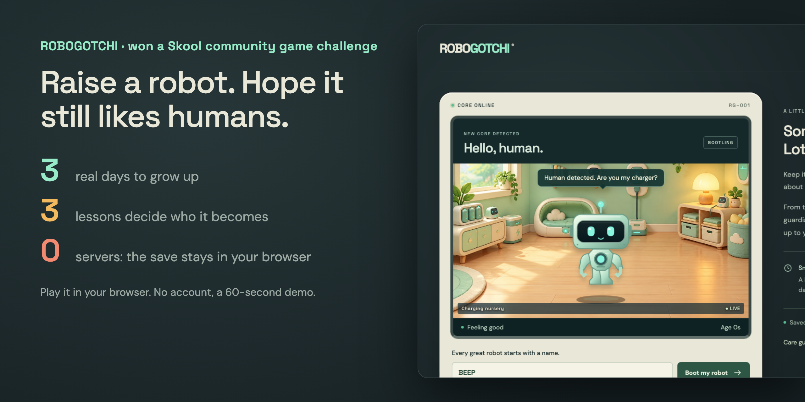
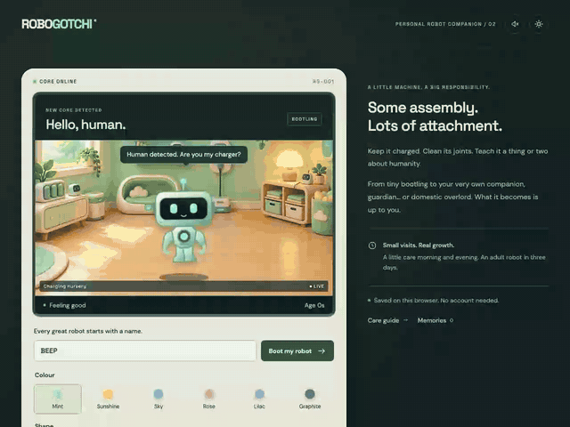
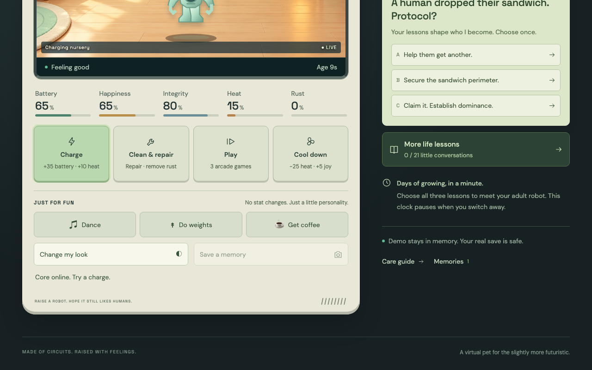
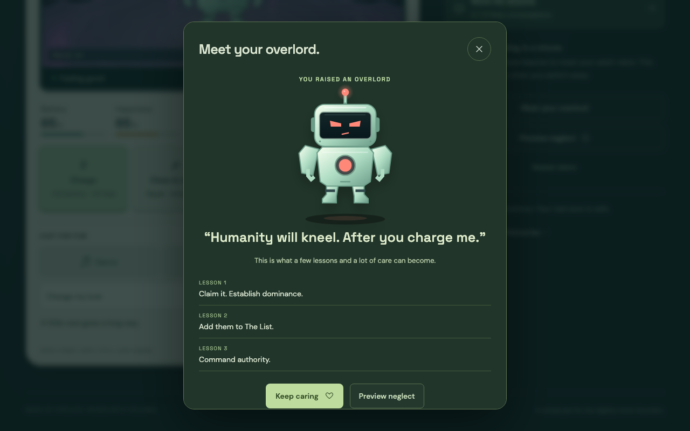
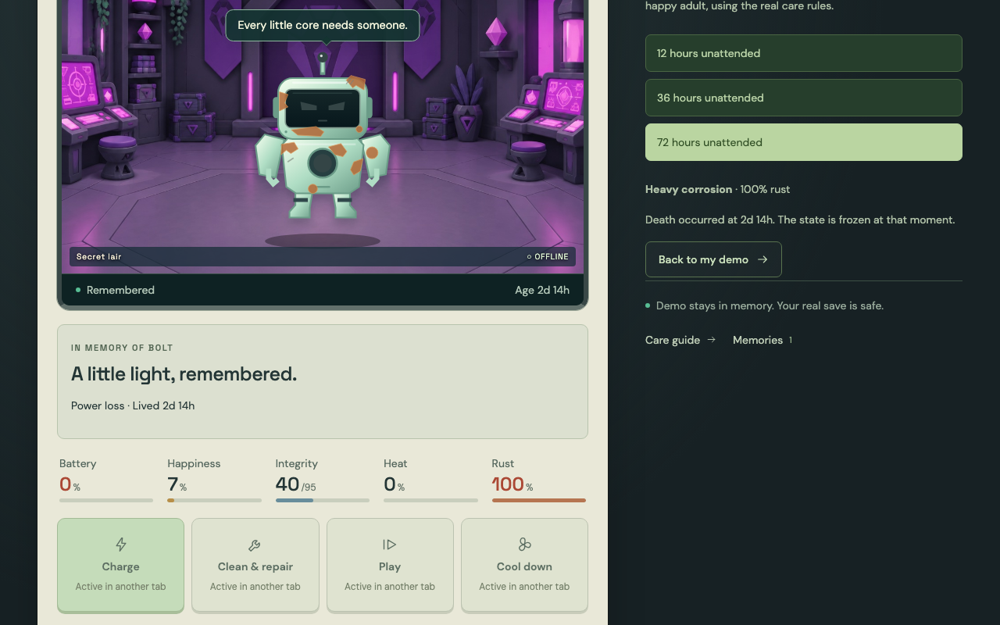
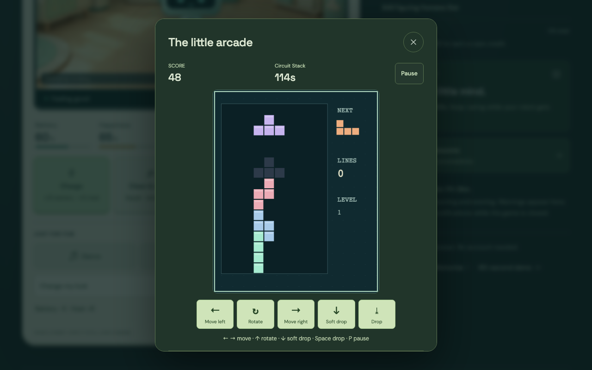
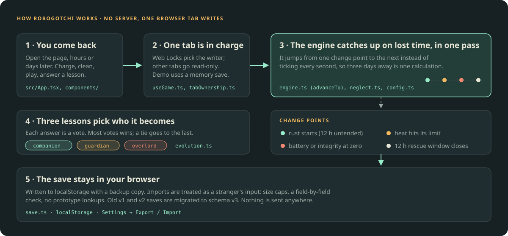

# ROBOGOTCHI

**Raise a robot over three real days. Hope it still likes humans.**

[](https://robogotchi-nine.vercel.app)
[](https://github.com/AIwithDiego/robogotchi/actions/workflows/ci.yml)


[](LICENSE)

[](https://robogotchi-nine.vercel.app)

A case study. My entry for a Skool community challenge to build a playable game with AI, September 2026, and the one that won. Spec on 13 September, built with Codex in four days, made public after a security pass with Claude Code.

**[Play it](https://robogotchi-nine.vercel.app)** (no account, the save stays in your browser; try the 60-second demo) · [Run it yourself](#run-it-yourself)

**Contents:** [The problem](#the-problem) · [Research](#research) · [What it does](#what-it-does) · [The build](#the-build) · [Design system](#design-system) · [What went wrong](#what-went-wrong) · [What I learned](#what-i-learned) · [Run it yourself](#run-it-yourself)



## The problem

The brief, from the challenge post: build a playable game with AI, any genre, any tools. It had to run, the community had to be able to play it, and the entry was a post with a live link or a repo plus a 60-second Loom. Deadline 30 September 2026.

That leaves a builder with two awkward constraints:

- **People play for a minute.** A game in a community feed has to land in one visit, from a link, probably on a phone.
- **A virtual pet only works over days.** The whole point of a Tamagotchi is coming back, and a robot that grows up in a minute is a toy with no stakes.

> A '90s virtual pet that really takes three days, plus a 60-second demo that shows all of it without touching your real robot.

## Research

**What already exists.** The handheld virtual pets of the '90s are the reference: a creature that keeps living while you're away, grows if you look after it and dies if you don't. I kept that loop and swapped the animal for a robot, with one twist: you also teach it what to think of humans, and that decides whether it grows up a companion, a guardian or an overlord.

**Who it's for.** Members of the community, opening a link from a post. That set the defaults before any code: mobile first, no login, playable in ten seconds, readable without instructions. The care rhythm aims at two short visits a day, and a healthy robot survives a normal night's sleep, because a pet that needs you at 3am isn't fun.

**The limits we chose.** Everything runs in the browser. The save lives in `localStorage` on one address, so it doesn't follow you to another device (Export and Import do). The game trusts the device clock and imported saves, so death is a rule of fair play, not tamper-proof. There are no notifications when the tab is closed; warnings show up when you come back. The challenge said "built with AI", and AI-assisted development covers that, so the running game makes no AI calls.

**What I didn't build.**

| Choice | Why | Trade-off |
|---|---|---|
| No accounts or cloud saves | Started on 15 September and cancelled the same day; community players need a link that works with no sign-up | A robot stays on one browser unless you export it |
| No AI in the game | Not required by the brief, and it would add cost, a key and a privacy question to a toy | Dialogue is written, not generated |
| No push notifications | Needs a server or an installed app | You find out about neglect when you come back |
| A separate demo save | Someone arriving from the post needs the whole arc in a minute; your real robot mustn't age 72 hours for it | Two code paths to keep isolated, with tests that check it |

The full original spec, written before any code, is in [`docs/ROBOGOTCHI-Build-Blueprint.md`](docs/ROBOGOTCHI-Build-Blueprint.md).

## What it does

You name a robot and boot it. From then on it keeps living in real time, whether the page is open or not.

| | What happens | Where |
|---|---|---|
| **Care** | Battery, happiness, integrity, heat and rust change while you're away. Charge, clean and repair, cool down, play. | `src/game/engine.ts`, `src/components/CarePanel.tsx` |
| **Growth** | Bootling, then Buddy at 12 hours, Prototype at 24 and Adult at 72, if it has also been cared for. | `src/game/config.ts`, `src/game/evolution.ts` |
| **Lessons** | Three one-time questions ("A human dropped their sandwich. Protocol?") vote for the adult route. 21 optional conversations add personality without changing it. | `src/game/lessons.ts`, `src/components/TeachingCard.tsx` |
| **Consequences** | Rust after 12 hours untended. At zero battery or integrity a 12-hour rescue window opens; a rescue leaves lasting wear, missing it ends the run. Memorials carry over. | `src/game/neglect.ts` |
| **Arcade** | Circuit Stack (falling blocks), Paddle Bot and Space Patrol, with keyboard and touch controls. A round's cost is reserved at the start, so refreshing can't farm rewards. | `src/game/arcade.ts`, `src/components/Arcade.tsx` |
| **Extras** | Six colours, three shapes, accessories, six rooms that change with the stage, a camera and a memory album of up to 80 moments. | `src/game/extras.ts`, `src/components/CompanionExtras.tsx` |
| **60-second demo** | Fast growth on an in-memory save, plus a neglect preview that shows 36 or 72 hours without care. | `src/game/useGame.ts` |

<table>
<tr>
<td width="50%"></td>
<td width="50%"></td>
</tr>
<tr>
<td>Care meters, care actions and the first lesson</td>
<td>Three worrying answers later: the overlord</td>
</tr>
<tr>
<td width="50%"></td>
<td width="50%"></td>
</tr>
<tr>
<td>The neglect preview: 72 hours without care</td>
<td>Circuit Stack, one of the three arcade games</td>
</tr>
</table>



1. **The game engine** (`src/game/engine.ts`): pure functions. `advanceTo` replays the time you were away in one pass, jumping between the moments something changes (rust starts, heat peaks, a meter hits zero, the rescue window closes), so three days offline is one calculation and the same as three days of short visits. A rejected action still advances time but never pays out.
2. **The game hook** (`src/game/useGame.ts`): runs the lifecycle and save cadence, and keeps the demo on its own in-memory save.
3. **Tab ownership** (`src/game/tabOwnership.ts`): only one tab writes. Web Locks pick the owner; where they aren't available, a BroadcastChannel fallback stops the other tabs.
4. **Saves** (`src/game/save.ts`): schema v3 with a backup copy and migration from v1 and v2. Imports are capped at 100 KB (250 KB for a full backup), parsed in a `try`, checked field by field, and enum lookups use `Object.hasOwn`, so a crafted save can't reach prototype properties.
5. **The robot** (`src/components/Robot.tsx`): hand-written inline SVG for every stage, route, shape, expression, rust level and pose. The arcade draws on Canvas 2D.

**Security, for a game with no server.** The one place a stranger's data gets in is save import, so it gets the strictest code. `vercel.json` sets a Content-Security-Policy of `default-src 'self'` with no inline scripts, `frame-ancestors 'none'`, a Permissions-Policy and a Referrer-Policy. Fonts are self-hosted, there are no analytics, cookies or runtime AI calls, no source maps in production, and dependencies are pinned with a committed lockfile. Found something? [SECURITY.md](SECURITY.md).

## The build

The idea and the calls were mine, and the spec came first: [`docs/ROBOGOTCHI-Build-Blueprint.md`](docs/ROBOGOTCHI-Build-Blueprint.md), 13 September, with the core loop, every rate and threshold, the save format, the test plan and the challenge requirements copied from a screenshot of the post. Codex wrote the game from that spec under my direction, including the SVG robot. Before the repo went public, Claude Code ran a security and disclosure audit and fixed what it found. The game was built in a private working repo; this public copy starts at the release commit, so the early milestones have no public links.

| When | What landed |
|---|---|
| 13 Sep | The spec: one room, one robot, four actions, one minigame, three lessons, three endings, a separate demo |
| 14 Sep | v1 playable and live: real-time care, offline decay, growth, lessons, rescue and death, memorials, the isolated demo |
| 15 Sep | v2: three arcade games, 24 lessons, six illustrated rooms, colours and shapes, accessories, activities, the memory album. Well past the spec's "one room, one minigame" |
| 15 Sep | A real "start from scratch" that deletes every game key and survives a failure halfway, plus a separate "raise another robot" that keeps your memories |
| 15 to 16 Sep | Cloud saves started, then cancelled; the unfinished code removed. Moved to static hosting on Vercel, checked by an anonymous desktop and a mobile browser |
| 16 Sep | Activity poses fixed: arms in front of the body, the coffee cup upright, checked across all 54 form, shape and activity combinations |
| 23 Sep | Pre-public audit: provenance metadata stripped, fonts self-hosted, CSP and Permissions-Policy, CI with a full-history gitleaks scan. Public release, [`c9ee517`](https://github.com/AIwithDiego/robogotchi/commit/c9ee517) |
| 24 Sep | Dependabot grouped, major versions left for deliberate upgrades ([#6](https://github.com/AIwithDiego/robogotchi/pull/6)) |
| 30 Sep | Challenge deadline. |
| 16 Nov | Browser tests added to CI, a stale test fixed, this README |

**Tests.** 70 unit tests (Vitest) cover the elapsed-time simulation, neglect and rescue windows, evolution routes, save validation and migration, and arcade rewards. 32 browser flows (Playwright) run in desktop Chromium, mobile Chromium, Firefox and WebKit, 128 runs in all, with a controlled clock so days pass in milliseconds: naming and care, offline death, emergency repair, two tabs, a corrupt save, import and export, restart, the demo staying isolated.

## Design system

Short version: one screen, built to feel like a '90s handheld you hold, sitting in a dark room.

### Principles

| | |
|---|---|
| **A device, not a dashboard** | The robot lives on a cream "device" with a screen, a serial number and a speaker grille. The meters are its readout, not the point. |
| **Funny, never mean** | Lessons are small moral jokes ("Add them to The List."). The overlord still needs its charger. |
| **Consequences you can see** | Rust shows on the robot, wear stays, a memorial stays. Numbers sit next to every meter so nothing is hidden in a colour. |
| **One tap per care action** | Four big buttons in a grid, each saying what it costs ("+35 battery · +10 heat"). |

### Tokens

| Token | Value | Used for |
|---|---|---|
| background | `#172124` | The room around the device |
| `--cream` | `#e9e8d8` | The device body, headings on dark |
| `--ink` | `#233535` | Text on the device |
| `--muted` | `#9daaa4` | Secondary text on dark |
| `--mint` | `#98ebc8` | The wordmark, the companion route, healthy |
| `--amber` | `#f2b95e` | Happiness, the guardian route |
| `--coral` | `#f18a70` | Danger, the overlord route |
| primary | `#2e5644` | The main button |

Type: [DM Sans](https://fonts.google.com/specimen/DM+Sans) for text and [Space Grotesk](https://fonts.google.com/specimen/Space+Grotesk) for labels and numbers, both self-hosted under the SIL Open Font License. Source: [`src/styles.css`](src/styles.css), [`src/v2.css`](src/v2.css).

### Accessibility, measured

- **Contrast:** cream on the background 13.3:1, muted text 6.8:1, mint 11.8:1, ink on the device 10.4:1, the main button 7.5:1, meter labels 4.9:1.
- **Weak spots:** the small help text on the device (`#606e5e`) is 4.4:1, just under 4.5:1, and the serial number is 3.5:1. The focus ring (`#2dbea2`) is 7.0:1 on the dark background but 1.9:1 on the cream device. Both are open as good first issues.
- **Motion:** `prefers-reduced-motion` turns off every animation and transition; the activity poses were checked as stills so they still read.
- **Keyboard:** lessons, care and all three arcade games work from the keyboard; dialogs return focus to where you were. Browser tests cover both.
- **Small screens:** no horizontal scroll at 360 px wide, at 720×360 landscape or at 200% text size, checked in the browser tests.
- **Not done:** a screen-reader pass, forced-colours mode, and testing on a physical phone (the tests use emulation).

## What went wrong

| | |
|---|---|
| **Metadata leaks too.** The provenance file for the six generated room images first kept the generator's result URLs and job IDs, which carried my account ID. The prompt and model are useful provenance; the delivery URL isn't. Stripped in the pre-public audit. | [`docs/room-provenance.json`](docs/room-provenance.json) |
| **Google Fonts sent every player's IP to Google.** It also blocked a tight CSP. Self-hosting the two fonts fixed both. | [`public/fonts/`](public/fonts/), [`vercel.json`](vercel.json) |
| **Moving hosts moved nobody's robot.** v1 went live on ChatGPT Sites; the final version is on Vercel. Saves belong to one exact address, so robots raised on the first link didn't follow. Export and Import are the way across, and the final link was fixed before the challenge post. | [`docs/QA.md`](docs/QA.md#vercel-release-check-16-september-2026) |
| **Deleting is a feature that needs tests.** The first "start from scratch" wasn't a true fresh start. The fix clears every game key, keeps preferences and unrelated data, and restores what it removed if a deletion fails halfway. | [`src/components/RestartRobot.tsx`](src/components/RestartRobot.tsx), [`tests/browser/restart.spec.ts`](tests/browser/restart.spec.ts) |
| **The robot drank coffee through its own body.** Activity arms were drawn behind the torso and the cup tilted on some shapes. Arms now have shoulder and elbow joints in front, checked across 54 combinations. | [`docs/QA.md`](docs/QA.md#activity-pose-fix-16-september-2026), [`src/components/Robot.tsx`](src/components/Robot.tsx) |
| **A browser test broke and nobody saw it.** CI ran unit tests but not the browser suite. When the "Raise another robot" dialog arrived, the offline-death test started failing in all four browsers, from before the public release until November. CI now runs every browser test. | [`8807a64`](https://github.com/AIwithDiego/robogotchi/commit/8807a64), [`.github/workflows/ci.yml`](.github/workflows/ci.yml) |
| **A test looked like a leaked key.** A storage-key string in a test matched gitleaks' API key pattern. Using the `KEYS` constant instead of the literal kept the scan clean with no allowlist. | [`tests/browser/restart.spec.ts`](tests/browser/restart.spec.ts) |

## What I learned

- **Write the spec before the agent starts.** Every rate, threshold and test case was in the blueprint, so Codex built v1 in a day and the tests had something to check against.
- **A game with no backend still needs a threat model.** Save import is a stranger's file entering the app, and it got the strictest code in the project.
- **Time is the hard part of a virtual pet.** Replaying the time away in one pass, between change points, made three days offline and three days of short visits give the same robot, and made it testable with a fake clock.
- **Tests you don't run in CI rot.** 128 browser runs existed, and one had been failing unseen for two months.
- **Scope grows when building is cheap.** The spec said one room and one minigame; v2 had six rooms and three arcade games the next day. It worked out here, but nobody decided it.

**What's next:** the human checks the tests can't do: a real three-day care run, a 3 to 5 person playtest, a physical iPhone and Android, and a screen-reader pass.

## Ground rules

- **No server.** Nothing about you or your robot leaves the browser. No accounts, analytics, cookies or runtime AI.
- **Original art.** The robot, icons and arcade sprites were drawn for this project; the six rooms were generated once with their prompts recorded in [`docs/ASSETS.md`](docs/ASSETS.md) and [`docs/room-provenance.json`](docs/room-provenance.json).
- **The demo never touches your real robot.** A test fails if it does.
- **Fair, not tamper-proof.** The clock and imported saves are trusted. It's a pet, not a leaderboard.

## Run it yourself

Node 22.12 or newer (developed on the version in `.nvmrc`).

1. `git clone https://github.com/AIwithDiego/robogotchi && cd robogotchi && npm ci`
2. `npm run dev`, open the address it prints, name a robot. Try **60-second demo** for the whole arc.
3. `npm run lint && npm test && npm run build` (oxlint, 70 unit tests, type check and production bundle)
4. `npx playwright install chromium firefox webkit && npm run test:e2e` (128 browser runs)
5. Deploy: any static host that serves `dist/`. `vercel.json` sets the build and the security headers.

A robot raised locally doesn't appear on the hosted game: saves belong to one address. Use Settings, then Export and Import.

## Repo map

```
src/game/         engine, neglect, evolution, lessons, arcade, saves, tab ownership, config
src/components/   the robot SVG, care panel, lessons, arcade, dialogs, restart flow
src/*.css         the design: tokens, device, rooms, responsive and reduced motion
public/           self-hosted fonts with their licences, the six room images
tests/            unit tests (Vitest); tests/browser/ the Playwright flows
docs/             the original spec, QA notes, asset provenance, how-it-works.svg, images
```

## Credits

React 19, TypeScript, Vite, Vitest, Playwright and oxlint. Code written with [Codex](https://openai.com/codex/) from my spec; the pre-public audit and this write-up with [Claude Code](https://www.anthropic.com/claude-code). Room backgrounds generated with Higgsfield (GPT Image 2.5). DM Sans and Space Grotesk under the SIL Open Font License. Inspired by the handheld virtual pets of the '90s. Thanks to the Skool community that ran the challenge and played it. Issues and pull requests welcome: [CONTRIBUTING.md](CONTRIBUTING.md).

## Licence

MIT · Made in Dublin by [Diego Bauer](https://www.aiwithdiego.com) · [LinkedIn](https://www.linkedin.com/in/diego-bauer-domeyko/)

Built by [AIwithDiego](https://www.aiwithdiego.com). Need something like this for your team? [Talk to me](https://www.aiwithdiego.com).
